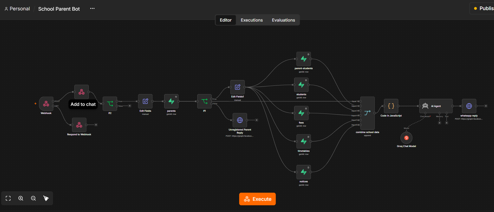
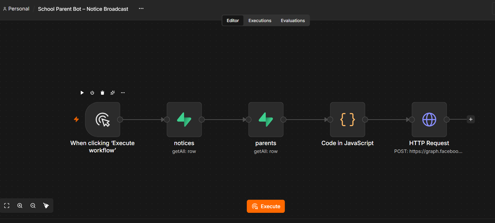
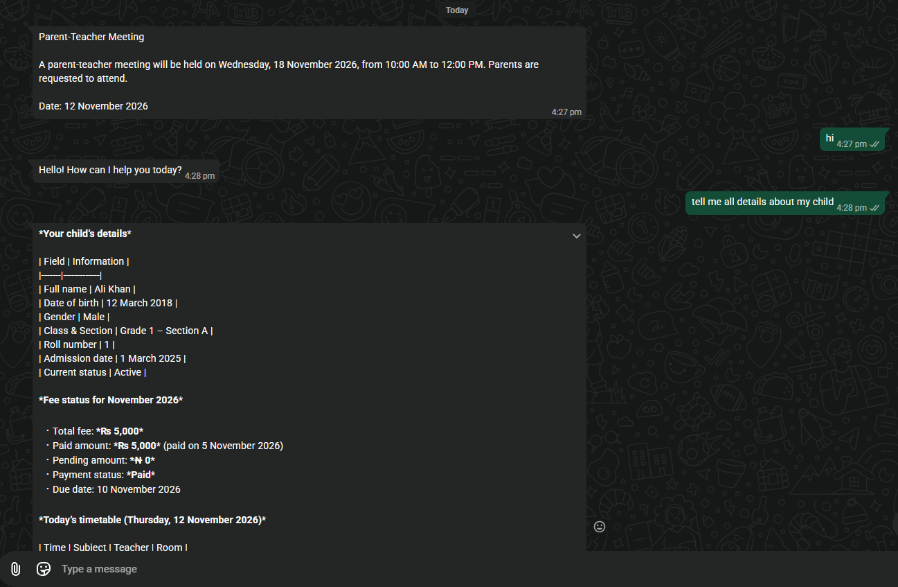
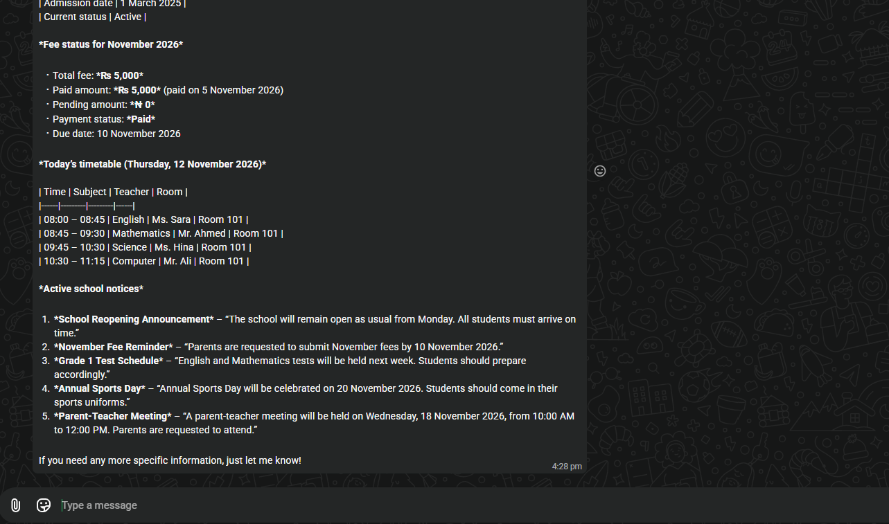

# School Parent Bot

🎥 **Demo video:** [Watch the demo on Google Drive](https://drive.google.com/file/d/1mKm98fhbpDxEtn_g3ltSWxTcF9mRF3lf/view?usp=sharing)

A WhatsApp-based school communication assistant built with **n8n**, **WhatsApp Cloud API**, **Supabase**, and **Groq**. Parents can ask for school-related information, while school staff can prepare and broadcast new notices through a separate manually triggered workflow.

> **Privacy and setup note:** This repository contains cleaned n8n workflow exports and documentation only. It does not contain live API keys, WhatsApp access tokens, Supabase credentials, or real parent/student database records. Configure credentials in your own n8n instance before using the workflows.

## Features

### 1. WhatsApp Parent Chatbot
- Receives incoming WhatsApp messages through an n8n webhook.
- Checks whether the sender's WhatsApp number is registered in the `parents` table.
- Looks up only the student(s) linked to that parent.
- Retrieves relevant school records from Supabase: student details, fees, class timetable, and active notices.
- Uses a Groq chat model through an n8n AI Agent to prepare a concise response.
- Sends the response through the WhatsApp Cloud API.
- Sends a separate response when the sender is not registered.
- Includes system instructions to avoid exposing another parent's or student's private information and to avoid inventing missing school records.

### 2. Notice Broadcast
- Starts when an administrator clicks **Execute workflow** in n8n.
- Fetches the newest notice where `is_active = true` and `is_broadcasted = false`.
- Fetches all parent records from Supabase.
- Creates one output item for each parent with a phone number.
- Sends a WhatsApp template message using the `school_notice_broadcast` template and its three body parameters: title, notice details, and publish date.

The final broadcast workflow is configured for all parent records, not only the single test recipient. Do not run a live broadcast until the template is approved and the school's permission/opt-in requirements are satisfied.

## Architecture

```text
Incoming WhatsApp message
        |
        v
WhatsApp Cloud API Webhook (n8n)
        |
        v
Lookup parent by WhatsApp phone in Supabase
        |
        +---- Not registered ----> WhatsApp registration response
        |
        v
Lookup linked student(s), fees, timetable, active notices
        |
        v
Combine verified school data
        |
        v
Groq AI Agent
        |
        v
WhatsApp Cloud API reply
```

```text
Admin clicks Execute workflow
        |
        v
Fetch latest active, not-yet-broadcast notice
        |
        v
Fetch all parents
        |
        v
Code node: one message item per parent
        |
        v
HTTP Request: WhatsApp approved template
```

## Repository structure

```text
.
├── workflows/
│   ├── school-parent-bot.json
│   └── notice-broadcast.json
├── database/
│   └── schema.sql
├── docs/
│   ├── SETUP_GUIDE.md
│   ├── TEST_CHECKLIST.md
│   └── SECURITY_AND_LIMITATIONS.md
├── screenshots/
│   ├── school-parent-bot-workflow.png
│   ├── notice-broadcast-workflow.png
│   ├── whatsapp-notice-and-chat.png
│   └── whatsapp-chat-details.png
├── .env.example
├── .gitignore
└── README.md
```

## Requirements

- A running n8n instance (the workflows were exported from n8n 2.44.x; verify node compatibility with your installed version).
- A Supabase project with the tables/columns used by the workflows.
- A Groq API key and an available chat model.
- A Meta WhatsApp Business Platform app, WhatsApp Business Account, and a connected phone number.
- A public HTTPS URL for the n8n webhook (for example, a stable tunnel or deployed n8n URL).
- An approved WhatsApp message template for proactive notices sent outside an open customer-service window.

## Quick setup

1. Create or select a Supabase project.
2. Review `database/schema.sql`. For a fresh database, run it in the Supabase SQL Editor. For an existing database, compare the reference schema with the current tables before applying any SQL.
3. Open n8n and import `workflows/school-parent-bot.json` and `workflows/notice-broadcast.json` separately.
4. Reconnect the Supabase credentials on every Supabase node.
5. Reconnect the Groq credential on the **Groq Chat Model** node.
6. In both workflows, replace `YOUR_WHATSAPP_PHONE_NUMBER_ID` in the HTTP Request URL with the phone-number ID from the target WhatsApp Business Account.
7. In each WhatsApp HTTP Request node, set the `Authorization` header to `Bearer YOUR_WHATSAPP_ACCESS_TOKEN` using a secure n8n credential or protected configuration. Do not commit a real token.
8. Configure the main chatbot webhook URL in Meta's WhatsApp webhook settings and subscribe to the message event. Use the verification token configured for your n8n webhook setup.
9. Create the `school_notice_broadcast` template in WhatsApp Manager with language `en_US` and three body parameters in this order: notice title, notice message, publish date.
10. Keep both imported workflows inactive until credentials, webhook configuration, template status, and recipient eligibility have been checked.

For the detailed steps, see [`docs/SETUP_GUIDE.md`](docs/SETUP_GUIDE.md).

## WhatsApp template and recipient requirements

The broadcast workflow sends a **template** message. The template must exist in the sending WhatsApp Business Account and be approved/enabled before proactive broadcasts are sent. The template used in this project is named `school_notice_broadcast`, language `en_US`, with three text parameters.

WhatsApp policy also requires businesses to message people who have opted in to receive messages from them. A customer's inbound message opens a 24-hour customer-service window for that customer; within that window free-form replies are allowed. Outside the window, an approved template is required to initiate or continue a business-initiated message. A test message from one parent's number does not open a service window for every other parent.

Check the current Meta policy before deployment:
- [WhatsApp Business Messaging Policy](https://whatsappbusiness.com/policy/)
- [WhatsApp Business Platform onboarding guidance](https://whatsappbusiness.com/wp-content/uploads/2026/04/Onboarding-to-the-WhatsApp-Business-Platform.pdf)

## Important known limitation: broadcast status update

The notice workflow filters for `is_broadcasted = false`, but the exported workflow does **not yet automatically update** that column to `true` after all parent message requests succeed. Until an update step and proper partial-failure handling are added, do not repeatedly execute the workflow for the same notice.

After verifying that the full broadcast completed successfully, an administrator can mark that notice as broadcast manually in Supabase SQL Editor:

```sql
UPDATE public.notices
SET is_broadcasted = TRUE
WHERE id = 0; -- Replace 0 with the notice_id shown in the Code node output.
```

Do not mark the notice as broadcasted if only some requests succeeded. Review failed items first.

## Demo

Watch the demo video: [Google Drive link](https://drive.google.com/file/d/1mKm98fhbpDxEtn_g3ltSWxTcF9mRF3lf/view?usp=sharing)

The demo shows the two n8n workflow layouts and a test notice delivered to one test WhatsApp number, followed by the chatbot answering a parent's question. It is **not evidence of a live 25-parent broadcast**.

## Screenshots

**Main parent chatbot workflow (n8n)**



**Notice broadcast workflow (n8n)**



**Notice received on WhatsApp, then the chatbot replying to a parent**





## Security

- Never commit `.env`, live access tokens, service-role keys, or real parent/student data.
- Use server-side credentials in n8n. Do not put Supabase service-role keys or WhatsApp tokens in frontend code.
- Use synthetic records for public demos and screenshots.
- Keep the parent-to-student relationship lookup in place and verify that each sender can access only their linked student records.
- Check the screenshots and demo video before public posting to make sure no personal details are visible.

## Status at packaging

- Main chatbot workflow: exported and cleaned; credentials must be reconnected after import.
- Notice broadcast workflow: exported and cleaned; all-parent path configured; credentials and approved template are required before live use.
- WhatsApp template: it was reported as **In review** during project preparation on 12 November 2026. Check WhatsApp Manager for the current live status before sending.
- Public GitHub package: contains no live secrets or real database seed records.
